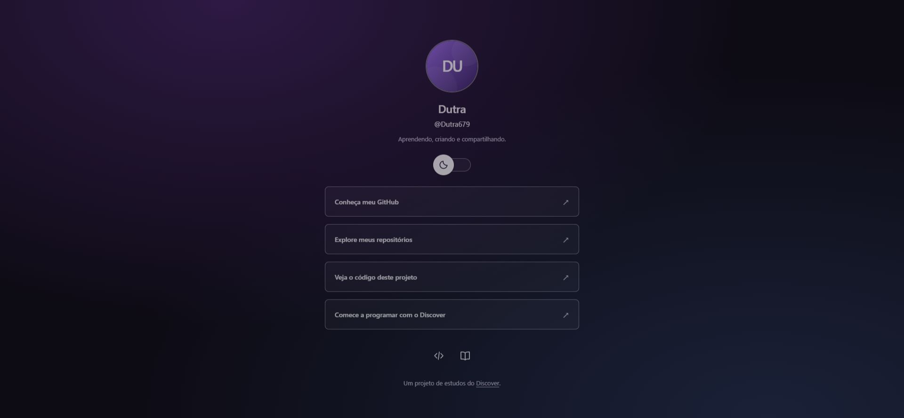

# DevLinks

Agregador de links baseado no projeto DevLinks do curso [Discover da Rocketseat](https://www.rocketseat.com.br/discover).



## Desenvolvimento

Implementação desenvolvida com assistência de IA (Codex), a pedido de Dutra. Os commits registram mudanças reais realizadas neste projeto, organizadas conforme os tópicos do curso.

## Etapas

1. Estrutura HTML e configuração do projeto.
2. CSS, fundo e perfil.
3. Lista de links, Flexbox e rodapé.
4. Variáveis CSS e botão para os temas.
5. JavaScript para alternar tema e avatar.
6. Responsividade, animações e documentação.

## Executar

Abra `index.html` no navegador, ou abra a pasta no VS Code e use o Live Server. Não há dependências nem etapa de build.

## Funcionalidades

- Perfil e links do GitHub de Dutra.
- Tema claro e escuro com troca de avatar.
- Preferência de tema salva no navegador, quando o armazenamento está disponível.
- Layout para celular e computador.
- Navegação por teclado, nomes acessíveis e texto alternativo nas imagens.
- Animações que respeitam a preferência por movimento reduzido.

## Tecnologias

HTML, CSS e JavaScript, sem framework. Os avatares e ícones são SVGs locais; os fundos são gradientes CSS. A página não depende de bibliotecas, fontes remotas ou serviços externos para renderizar.

## Estrutura

```text
Discover/
├── index.html
├── style.css
├── script.js
├── assets/
│   ├── avatar-dark.svg
│   ├── avatar-light.svg
│   └── preview.png
└── README.md
```

## Personalizar

Edite o nome e os endereços dos links em `index.html`. Substitua os avatares em `assets/` e ajuste os textos alternativos em `index.html` e `script.js`. As cores ficam nas variáveis de `:root` e `.light` em `style.css`.

## Publicar no GitHub Pages

No repositório, abra **Settings → Pages**, selecione **Deploy from a branch**, escolha **main** e a pasta **/(root)**, e salve. O endereço será exibido pelo GitHub quando a publicação terminar.

## Créditos

Conceito do DevLinks e tópicos de referência: [Discover da Rocketseat](https://www.rocketseat.com.br/discover). Código desta implementação e avatares criados com assistência de Codex. O projeto não é uma cópia do repositório apresentado como referência.

## Verificação

Verificado em navegador nos temas claro e escuro, incluindo alternância por teclado, troca de avatar e persistência após recarregar. Layout inspecionado em telas de 320 px e 390 px, sem rolagem horizontal. JavaScript validado com `node --check script.js`.
